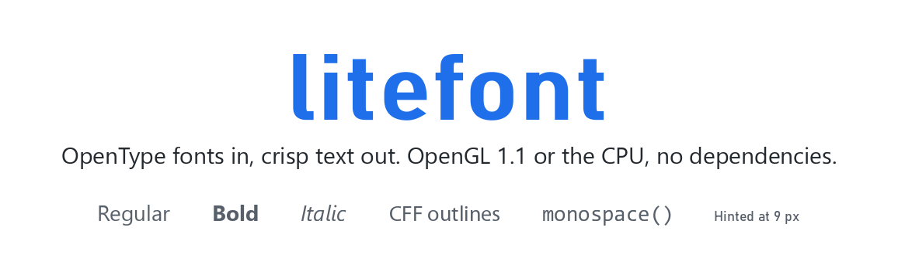
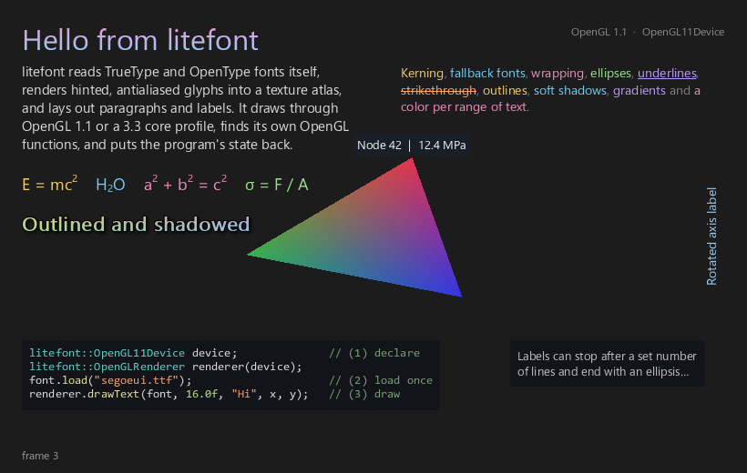
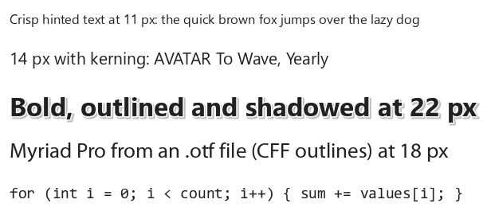

<h1 align="center"></h1>

A small font engine in C++20: OpenType fonts in, crisp text out, drawn through OpenGL (1.1 fixed function or a 3.3 core profile) or rendered on the CPU.

No third-party libraries and no extension loader: litefont finds the few OpenGL functions it needs by itself. Load a font once and call `drawText` wherever your program already draws, next to `glBegin`/`glEnd` or your own shaders.

```cpp
#include <litefont/litefont.h>

litefont::Font font;                          // 1. declare
litefont::OpenGL11Device device;              //    or OpenGL33Device in a 3.3 core context
litefont::OpenGLRenderer renderer(device);

void init() {
	font.load("DejaVuSans.ttf");              // 2. load once
}

void display() {
	// ... your own OpenGL drawing ...
	renderer.drawText(font, 16.0f, "Hello world", 20.0f, 40.0f);   // 3. draw
}
```

## Contents

- [Features](#features)
- [Output](#output)
- [Dependencies](#dependencies)
- [Building](#building)
- [Using litefont in your project](#using-litefont-in-your-project)
- [Usage](#usage)
- [Examples](#examples)
- [Tests](#tests)
- [Project layout](#project-layout)
- [License](#license)

## Features

| | |
|---|---|
| **Fonts** | TrueType and CFF (`.otf`) outlines, collections (`.ttc`, `.otc`), cmap formats 4 and 12, kerning from GPOS or the `kern` table, names and traits. Every read is bounds-checked, so damaged files fail cleanly. |
| **Families** | Regular, bold, italic and bold italic faces, with bold and italic simulated when a face is missing; fallback families for characters a font lacks; a catalog that finds families by name in a folder you choose. |
| **Glyphs** | Exact-area antialiasing with vertical hinting, so small text has solid baselines and x-heights; outlines, sharp and blurred shadows; all cached in a texture atlas. Gradients with a color in each corner of the text, blended by the GPU at no atlas cost. |
| **Layout** | Wrapping, alignment, tabs, line and letter spacing, line limits with an ellipsis, superscripts and subscripts, underline and strikethrough, colors and styles per range of text, anchors and quarter-turn rotation for labels. |
| **Editing** | Caret boxes, selection rectangles, hit tests and caret movement for building text fields. |
| **Drawing** | Immediate-mode `OpenGLRenderer` over `OpenGL11Device` (fixed function, any compatibility context) or `OpenGL33Device` (one shader, core profiles); text on pixels, or in your own transform (your matrix, or the OpenGL matrix stack) re-rendered at the size it shows; retained `TextRenderer` over any `GraphicsDevice`; `SoftwareDevice` renders to images on the CPU and matches OpenGL to within one level. |

## Output

The freeglut example. The program draws a triangle with `glBegin`/`glEnd`, and litefont draws the text on top through OpenGL 1.1:
- a title shaded pink at the top to light blue at the bottom
- a wrapped paragraph about the library
- a feature list with a color per range, an underline and a strikethrough
- equations with superscripts and subscripts, each in its own color
- bold text with an outline, a blurred shadow and a different color in each corner
- the code that draws it, in a monospaced font with syntax colors, on a background box
- a label held to two lines and cut with an ellipsis
- a name tag following the triangle's corner, and a rotated axis label

Run with `--core`, the same text is drawn in an OpenGL 3.3 core profile context through `OpenGL33Device`.

<p align="center"></p>

The same engine on the CPU (`SoftwareDevice`), at 150 percent scale: hinted small text, kerning, an outlined and shadowed label, a CFF (`.otf`) font and monospaced code.

<p align="center"></p>

## Dependencies

| What | Needed for | Notes |
|---|---|---|
| A C++20 compiler with `<format>` | everything | Visual Studio 2022 17.2 or newer, GCC 13 or newer, Clang 17 or newer |
| [CMake](https://cmake.org) 3.20 or newer | building | |
| OpenGL (comes with the system) | `OpenGLRenderer` and the OpenGL devices | turn off with `-DLITEFONT_OPENGL=OFF` for CPU-only use |
| [freeglut](https://freeglut.sourceforge.net) | the freeglut example only | through vcpkg, your package manager or Homebrew (on macOS it needs XQuartz) |
| Python 3 and [fontTools](https://github.com/fonttools/fonttools) | the optional reference tool only | `tools/oracle` |

The library itself uses only the C++ standard library and the system's OpenGL. It includes no OpenGL header and needs no GLEW, GLAD or other loader: `source/OpenGLFunctions.cpp`, the only file that knows the operating system, finds each function at run time (`wglGetProcAddress` on Windows, the OpenGL framework on macOS, EGL or GLX on Linux).

So far litefont has been built and tested with Visual Studio 2026 on Windows, in OpenGL 1.1 (compatibility) and 3.3 core contexts. The code is portable C++20, and the CMake setup covers GCC and Clang on Linux and macOS, but those builds, and the Linux and macOS function lookup, have not been tried yet.

## Building

```sh
git clone https://github.com/ShaneTransue/litefont.git
cd litefont
cmake -S . -B build
cmake --build build --config Release
```

This builds the library and its tests. To build the examples as well:

**Windows (vcpkg)**

```sh
vcpkg install freeglut
cmake -S . -B build -DLITEFONT_BUILD_EXAMPLES=ON -DCMAKE_TOOLCHAIN_FILE=<vcpkg>/scripts/buildsystems/vcpkg.cmake
cmake --build build --config Release
```

**Linux (Debian, Ubuntu)**

```sh
sudo apt install build-essential cmake libgl1-mesa-dev freeglut3-dev
cmake -S . -B build -DCMAKE_BUILD_TYPE=Release -DLITEFONT_BUILD_EXAMPLES=ON
cmake --build build
```

**macOS (Homebrew)**

```sh
brew install cmake freeglut
cmake -S . -B build -DCMAKE_BUILD_TYPE=Release -DLITEFONT_BUILD_EXAMPLES=ON
cmake --build build
```

### Options

| Option | Default | Effect |
|---|---|---|
| `LITEFONT_OPENGL` | `ON` | build `OpenGLRenderer` and the OpenGL devices, and link OpenGL |
| `LITEFONT_BUILD_TESTS` | `ON` when built on its own | build `litefont_tests` |
| `LITEFONT_BUILD_EXAMPLES` | `OFF` | build the examples (the freeglut one is built only when GLUT is found) |
| `LITEFONT_TEST_FONTS` | empty | a folder of real fonts for the tests that need them |
| `LITEFONT_INSTALL` | `ON` when built on its own | install rules and a CMake package |
| `LITEFONT_WARNINGS_AS_ERRORS` | `OFF` | treat compiler warnings as errors |
| `LITEFONT_SANITIZE` | `OFF` | build with AddressSanitizer |
| `BUILD_SHARED_LIBS` | `OFF` | build a shared library instead of a static one (on Windows the programs then go to `build/bin` next to the DLL) |

### Installing

```sh
cmake --install build --config Release --prefix <install folder>
```

This installs the headers, the library and a CMake package (`litefontConfig.cmake`).

## Using litefont in your project

With **FetchContent**, straight from GitHub:

```cmake
include(FetchContent)
FetchContent_Declare(litefont GIT_REPOSITORY https://github.com/ShaneTransue/litefont.git GIT_TAG main)
FetchContent_MakeAvailable(litefont)

target_link_libraries(app PRIVATE litefont::litefont)
```

As a **subdirectory** (a copy or a git submodule):

```cmake
add_subdirectory(litefont)
target_link_libraries(app PRIVATE litefont::litefont)
```

After **installing**:

```cmake
find_package(litefont REQUIRED)
target_link_libraries(app PRIVATE litefont::litefont)
```

When litefont is added to another project, only the library is built; its tests and examples stay off unless you turn them on.

## Usage

Everything is in the `litefont` namespace, and `<litefont/litefont.h>` includes what a program usually needs. Each class is documented in its header.

### Drawing with OpenGL

Pick the device that matches your context once, where you declare it; the renderer works the same over either:

| Device | Context | Draws with |
|---|---|---|
| `OpenGL11Device` | any compatibility context (the default in freeglut, GLFW, SDL and Qt) | fixed function and client arrays, next to `glBegin`/`glEnd` |
| `OpenGL33Device` | a 3.3 or newer context, core or compatibility | one small shader, a vertex array and buffers |

```cpp
litefont::OpenGL33Device device;
litefont::OpenGLRenderer renderer(device);

renderer.drawText(font, 24.0f, "Score: 120", 10.0f, 10.0f, litefont::Color4f{1.0f, 0.8f, 0.2f, 1.0f});
const litefont::Rectf box = renderer.measureText(font, 24.0f, "Centered");
renderer.drawText(font, 24.0f, "Centered", (width - box.width) / 2.0f, 100.0f);
```

- **Immediate:** every call draws at once, in order with your own drawing.
- **Cached:** each distinct string (font, size, style, color) keeps its layout and glyphs, so redrawing it costs no layout or glyph rendering, even when it moves every frame. The least recently drawn strings go once more than 1024 are kept (`setCacheCapacity`).
- **Coordinates:** pixels from the top-left corner of the current viewport, by default. Call `setScale(ratio)` on high-density screens.
- **OpenGL state:** each draw saves your state and restores it afterwards: `OpenGL11Device` with `glPushAttrib`, `glPushClientAttrib` and the matrix stacks; `OpenGL33Device` by reading each value it changes and setting it back. `setRestoreState(false)` skips that if you manage state yourself.
- **Context:** the device finds its OpenGL functions and creates its textures at the first draw, so both can be declared before the context exists. Call `release()` with the context current to delete them. `device.getError()` says why nothing was drawn (a missing function, or a shader that failed).

### Drawing in your own transform

By default text sits on the pixel grid. To draw it in your own coordinates instead (a zoomable 2D view, a rotating label, a point in a 3D scene), tell the device:

```cpp
// OpenGL 1.1: whatever you set on the matrix stack
glMatrixMode(GL_PROJECTION); glLoadIdentity(); glOrtho(-w / 2, w / 2, -h / 2, h / 2, -1, 1);
glMatrixMode(GL_MODELVIEW);  glLoadIdentity(); glRotatef(degrees, 0, 0, 1);
device.useMatrixStack();
renderer.draw(label);
device.useViewport();

// any device, including core profiles: a matrix (column-major, projection times model-view)
device.setMatrix(projection * view * model);
renderer.drawText(font, 0.5f, "A", x, y);   // a size of half a unit
device.useViewport();
```

- **Units:** positions and sizes are in your units, and text grows downward from its position. Y is up by default, as with `glOrtho(0, w, 0, h)` or world coordinates; call `device.setYUp(false)` for a y-down space.
- **Sharp at any zoom:** each string is rendered at about the size it covers on screen (in steps of a sixth of an octave), and your matrix carries it the rest of the way with linear filtering. Moving, turning or zooming it costs no new layout until the size crosses a step.
- **Clips** and `setScale` apply to the pixel grid only.

### Styled text and labels

A `Text` holds every setting of a piece of text; `renderer.draw(text, x, y)` draws it.

```cpp
litefont::FontFamily family(regular);
family.addFace(bold);                                   // real faces are used when present

litefont::Text label("E = mc2, in bold", family, 18.0f);
label.setStyleRuns({
	litefont::TextStyleRun{6, 1, litefont::FontStyle::Regular, litefont::TextScript::Superscript},
	litefont::TextStyleRun{12, 4, litefont::FontStyle::Bold}});
label.setOutline(litefont::TextOutline{1.0f, litefont::Color4f{0.0f, 0.0f, 0.0f, 1.0f}});
label.setShadow(litefont::TextShadow{litefont::Vector2f{2.0f, 2.0f}, litefont::Color4f{0.0f, 0.0f, 0.0f, 0.6f}, 3.0f});
label.setGradient(litefont::TextGradient::vertical(pink, lightBlue));   // or a color for each corner

litefont::Text axis("Stress (MPa)", family, 14.0f);
axis.setRotation(litefont::TextRotation::CounterClockwise);
axis.setAnchor(litefont::Vector2f{0.5f, 0.5f});         // centered on its position

renderer.draw(label, 20.0f, 40.0f);
renderer.draw(axis, 30.0f, 300.0f);
```

Other settings include wrap width, alignment, line and letter spacing, line limits with an ellipsis, colors per range, underline, strikethrough and a background box.

A gradient gives each corner of the text's box a color (`TextGradient{topLeft, topRight, bottomLeft, bottomRight}`, or `vertical` and `horizontal` for two). Glyphs, underlines and strikethroughs take the blend where they sit; color runs keep their own colors, and outlines, shadows and backgrounds keep theirs.

### Rendering on the CPU

```cpp
litefont::SoftwareDevice device;
litefont::GlyphRasterizer glyphs;
litefont::TextRenderer renderer(device, glyphs);

litefont::Text text("Rendered without a GPU", font, 20.0f);
text.setColor(litefont::Color4f{0.1f, 0.1f, 0.1f, 1.0f});
renderer.add(text);
renderer.update(1.0f);                                  // device scale

device.beginFrame(litefont::Size2i{400, 60}, litefont::Color4f{1.0f, 1.0f, 1.0f, 1.0f});
renderer.draw();
device.endFrame();
device.readPixels().save("text.pam");                   // PGM, PPM or PAM
```

### Fonts

- `Font::load(path, face)` reads a `.ttf`, an `.otf`, or one face of a `.ttc`; `Font::load(bytes)` reads a font already in memory.
- `FontFamily::addFallback(other)` takes characters the family lacks from another family, for example CJK text inside a Latin UI font.
- `FontCatalog::scan(folder)` reads only the names and traits of the fonts in a folder. `findFamily("Name", family)` then loads that family's faces.

litefont never searches the system for fonts. It reads the files and folders you give it.

## Examples

Build with `-DLITEFONT_BUILD_EXAMPLES=ON`. No fonts ship with litefont; pass any `.ttf`, `.otf` or `.ttc` file.

| Example | Run |
|---|---|
| `examples/freeglut`: a triangle drawn with `glBegin`, text on top, and a label that follows a moving point; the code sample uses the second font, a monospaced one, when given | `litefont_freeglut <font.ttf> [mono.ttf]` |
| the same text in an OpenGL 3.3 core profile context, through `OpenGL33Device` | `litefont_freeglut <font.ttf> --core` |
| comparing OpenGL against the CPU renderer in every space the device has (pixels, matrices with y down and up, the matrix stack), and checking that drawing leaves the OpenGL state as it was | `litefont_freeglut <font.ttf> --self-check` (add `--core` for the 3.3 device) |
| `examples/rasterize`: text to an image file on the CPU | `litefont_rasterize <font.ttf> "Hello" 16 hello.ppm --theme light` |

`litefont_rasterize` also takes `--scale`, `--width`, `--align`, `--style`, `--outline`, `--shadow` and `--pixel-advances`.

## Tests

```sh
ctest --test-dir build -C Release
```

The tests build their own small fonts byte by byte, so they need no font files, and they compare rendered images with the golden images in `tests/golden`. Tests that check real fonts run when given a folder of them:

```sh
cmake -S . -B build -DLITEFONT_TEST_FONTS=<folder of fonts>
```

or `litefont_tests --fonts <folder>`. `tools/oracle/dump_font.py` writes fontTools reference dumps into `out/reference`. The tests then compare every outline, metric, character mapping and kerning pair against them.

## Project layout

```
include/litefont/    public headers (litefont.h includes the usual ones)
source/              implementation
tests/               test suite and golden images
examples/            freeglut and command-line examples
doc/                 a short PDF guide (litefont.pdf) and its LaTeX source
tools/oracle/        fontTools reference dumps for the tests (optional)
cmake/               package configuration template
```

## License

litefont is released under the [MIT License](LICENSE). Copyright (c) 2026 Shane Transue.
